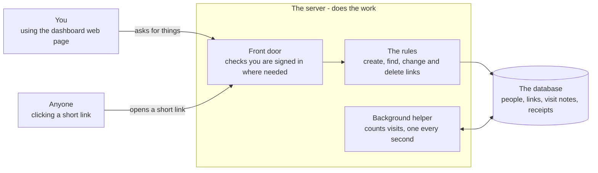
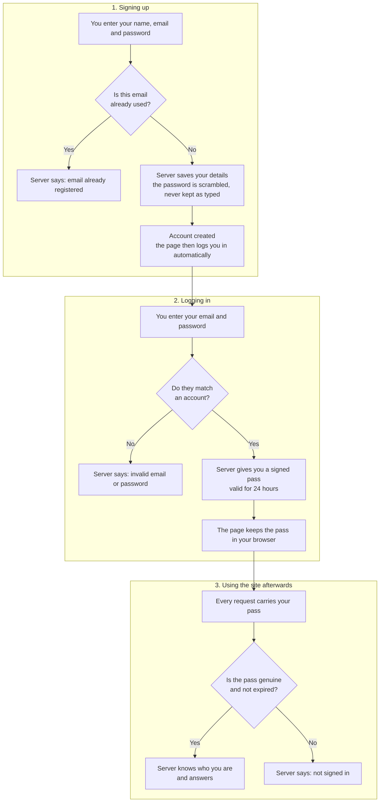
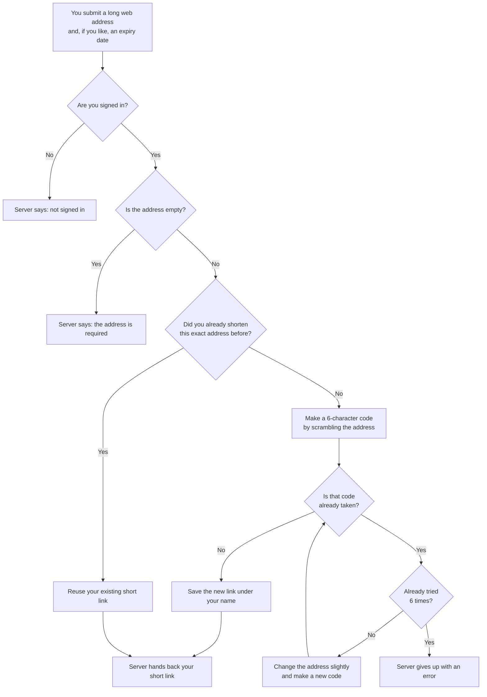
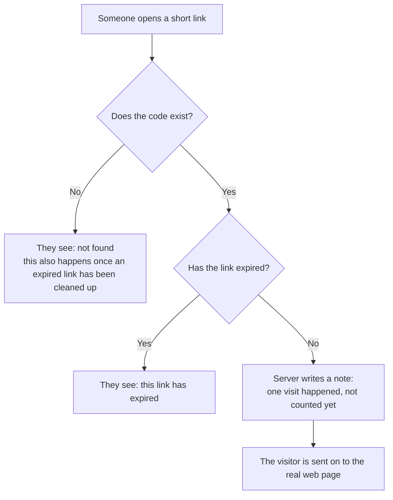
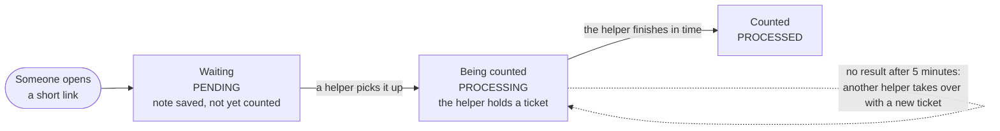
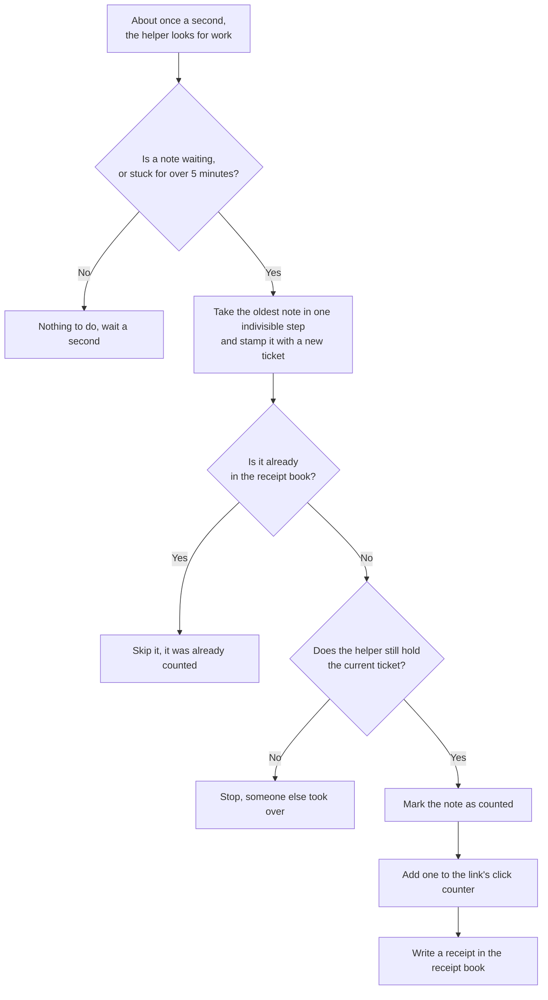
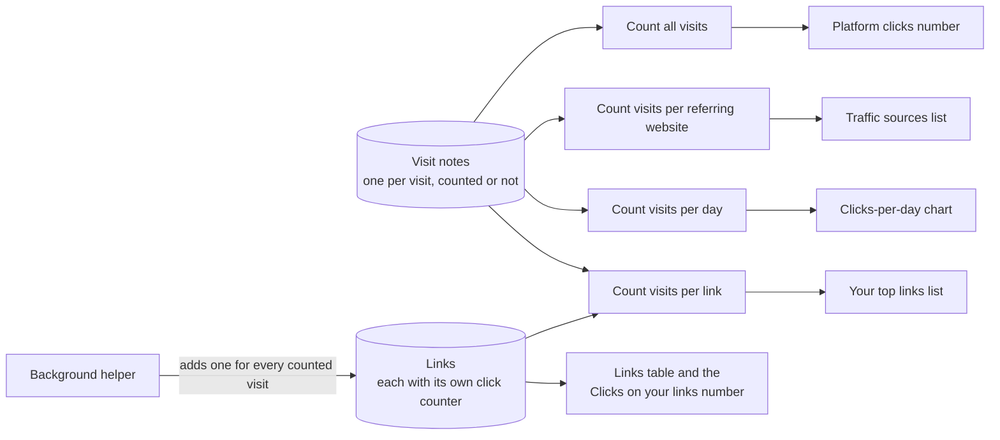
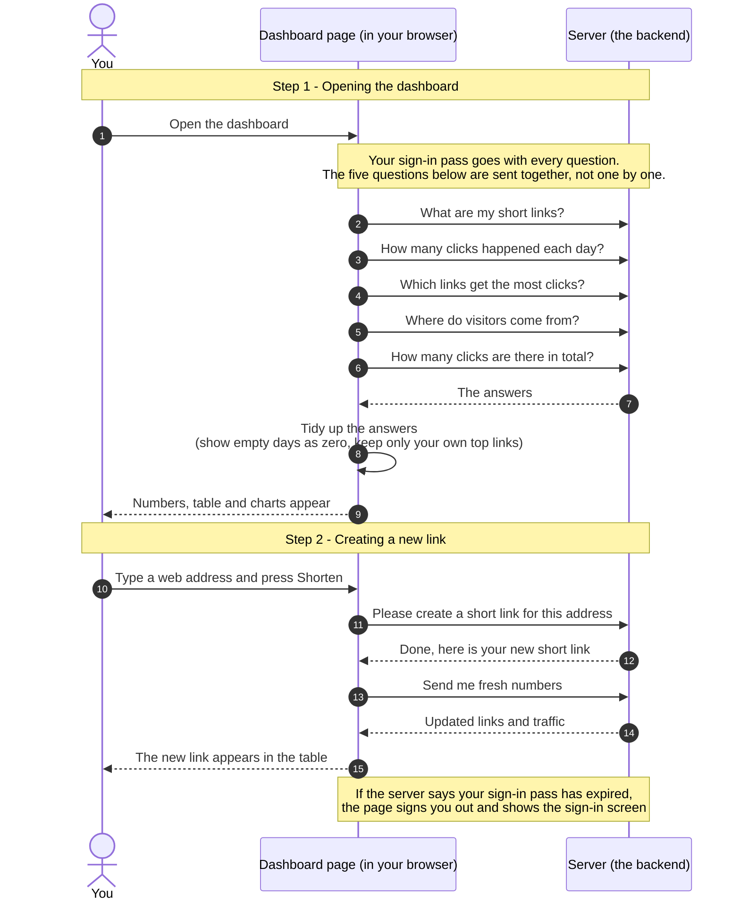
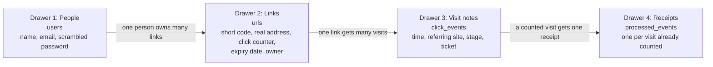

# URL Shortener

A full-stack URL shortening service with per-user link management and an asynchronous click-analytics pipeline. The backend is Spring Boot 3 with MongoDB and stateless JWT authentication. The frontend is a React + TypeScript dashboard.


---

## Table of contents

1. [Overview](#1-overview)
2. [Technology stack](#2-technology-stack)
3. [Architecture](#3-architecture)
4. [Click analytics and event processing](#4-click-analytics-and-event-processing)
5. [Analytics dashboard](#5-analytics-dashboard)
6. [API reference](#6-api-reference)
7. [Database design](#7-database-design)
8. [Project structure](#8-project-structure)
9. [Installation and setup](#9-installation-and-setup)
10. [Screenshots](#10-screenshots)
11. [Design decisions and engineering notes](#11-design-decisions-and-engineering-notes)
12. [What I learned](#12-what-i-learned)

---

## 1. Overview

> **In plain words:** You paste a long web address and get a short one back. Whenever anyone opens the short one, they are sent to the original page, and the system quietly records the visit so you can see which links are popular.

**What it does.** Signed-in users turn long URLs into short 6-character links, optionally with an expiry time. Anyone who opens a short link is redirected (HTTP 302) to the original URL, and every redirect is recorded as a click event. A background worker folds those events into per-link counters, and aggregation endpoints power a traffic dashboard.

**The problem it solves.** Short links are only useful if you can see how they perform. Counting clicks inside the redirect request would couple the hot path to counter updates. This project instead records a cheap event on redirect and processes events asynchronously, with an explicit claim → process → mark-done lifecycle and recovery for abandoned work.

**Key features**

| Area | Feature |
|---|---|
| Links | Deterministic 6-char Base62 codes (MD5-based) with collision retry; per-user de-duplication of identical URLs |
| Expiry | Optional `expiresAt`; inline `410 Gone` check plus a MongoDB TTL index that physically removes expired links |
| Auth | Registration and login, BCrypt (strength 12) password hashes, stateless HS-signed JWT (24 h) |
| Ownership | Stats, update and delete are scoped to the owning user; other users' codes return `404` |
| Analytics | Event-based click tracking, a background worker with atomic claims, and daily / top-link / referrer / total aggregations |
| Dashboard | React SPA: create, search, sort, re-schedule and delete links; clicks-per-day chart; traffic breakdowns; light/dark theme |
| API docs | Swagger UI via springdoc-openapi |

---

## 2. Technology stack

> **In plain words:** The server is written in Java and keeps its data in MongoDB. The web page you click around in is built with React. No extra services are needed: the to-do list for counting visits lives in the same database.

Only technologies present in the source are listed.

**Backend**

| Technology | Version | Used for |
|---|---|---|
| Java | 17 | Language / runtime (`java.version` in `pom.xml`) |
| Spring Boot | 3.3.4 | Application framework (`spring-boot-starter-parent`) |
| Spring Web | | REST controllers |
| Spring Data MongoDB | | Repositories, `MongoTemplate`, aggregation pipelines |
| Spring Security | | Filter chain, stateless sessions, BCrypt encoder |
| jjwt | 0.12.6 | JWT creation and verification |
| Bean Validation | | `@Valid` / `@NotBlank` on `ShortenRequest` |
| springdoc-openapi | 2.6.0 | Swagger UI and OpenAPI document |
| Lombok | | Boilerplate reduction in models and DTOs |
| Spring scheduling | | `@EnableScheduling` + `@Scheduled` background worker (in-process) |
| Maven | 3.x | Build (no wrapper is checked in) |

**Frontend** (`frontend/`)

| Technology | Version (per `package.json`) | Used for |
|---|---|---|
| React / React DOM | 18.3.1 | UI |
| TypeScript | 5.6 | Typing, strict mode |
| Vite | 8.4 | Dev server, API proxy, bundling |
| `@vitejs/plugin-react` | 6.3 | JSX transform / refresh |
| Vitest | 5.1 | Unit tests |

The frontend has **no UI, state or charting library**. The chart is hand-written SVG, and routing is a simple signed-in / signed-out switch.

**What is *not* used.** There is no message broker (Kafka, RabbitMQ), no Redis, and no separate worker service. The "queue" is the `click_events` collection, and the worker is a `@Scheduled` method inside the same Spring Boot process.

---

## 3. Architecture

> **In plain words:** There are three main pieces: the **web page** you use, the **server** that does the work, and the **database** that remembers things. A small helper inside the server counts visits in the background. The diagrams below show how they talk to each other.

### 3.1 System overview

> **In plain words:** Two kinds of visitors reach the server: you, through the dashboard, and anyone clicking a short link. Both go through the server's front door, which checks sign-in where needed. The server reads and writes the database, and the background helper does the same when counting.



The backend has no CORS configuration. In development the Vite dev server proxies `/api` to Spring, so the browser sees a single origin.

### 3.2 Authentication flow

> **In plain words:** Signing up stores your email and a scrambled version of your password. Logging in gives you a signed pass (the token), and every later request shows that pass. A missing or fake pass gets a "401, not signed in" answer.



`JwtAuthFilter` only *sets* the authentication when a valid token is present. A missing or invalid token simply continues down the chain unauthenticated, so public routes (`GET /{code}`, `/api/auth/**`, `/health`, Swagger) keep working and protected routes are rejected by the `HttpStatusEntryPoint` with `401`.

### 3.3 URL shortening flow

> **In plain words:** When you shorten a link, the server checks you are signed in, then checks whether you already shortened this exact address (if so, it simply returns that one). Otherwise it makes a 6-character code from the address, tweaks it and tries again if the code is taken, and saves it.



### 3.4 URL redirection flow

> **In plain words:** When someone opens a short link, the server looks it up. Unknown code: 404. Expired: 410. Otherwise it writes a note that a visit happened and sends the visitor on to the real page.



The event insert happens **synchronously** in the request. Only the *counting* is deferred.

### 3.5 Click event lifecycle

> **In plain words:** Each visit note moves through three stages: waiting (`PENDING`), being counted (`PROCESSING`), and counted (`PROCESSED`). If a helper takes longer than 5 minutes, another one may take over.



| Transition | Triggered by | Condition |
|---|---|---|
| `[*]` to `PENDING` | `UrlService.resolveAndTrack` | An active link was opened |
| `PENDING` to `PROCESSING` | `ClickEventProcessor.claimEvent` | Oldest `PENDING` event, claimed atomically |
| `PROCESSING` to `PROCESSED` | `ClickEventProcessor.processEvent` | `_id`, `claimToken` and `PROCESSING` all still match |
| `PROCESSING` to `PROCESSING` | `ClickEventProcessor.claimEvent` | `claimedAt` is older than 300 s: a new `claimToken` is issued and the previous holder is fenced out |

### 3.6 Event processing sequence

> **In plain words:** About once a second, the helper takes the oldest waiting note, checks it hasn't been counted already, ticks it off, adds one to the link's counter, and writes a receipt. If someone else got the note first, the helper just stops.



### 3.7 Analytics data flow

> **In plain words:** Two things feed the dashboard: the link counters (updated by the helper) and the raw visit notes (read directly for the charts and rankings). They are separate, so they can briefly show different totals.



Note the two independent counting paths: `urls.clickCount` (updated by the worker, once per *processed* event) and the aggregation endpoints (computed directly from *all* `click_events`). See [4.6](#46-two-click-counts-and-why-they-can-differ).

---

## 4. Click analytics and event processing

> **In plain words:** Every visit leaves a note. A background helper turns notes into counts, one at a time, with safeguards so a visit isn't counted twice and a stuck note isn't lost. This section also says plainly what those safeguards do and do not guarantee.

Implemented in `UrlService.resolveAndTrack`, `ClickEventWorker`, `ClickEventProcessor`, and `AnalyticsService`.

### 4.1 How click events are generated

> **In plain words:** A visit writes one note: the link code, the time, the website that sent the visitor (or "Direct"), and the visitor's browser details. The redirect waits for this note to be saved.

When `GET /{code}` resolves an active link, `UrlService.resolveAndTrack` builds a `ClickEvent` and saves it **before** returning the 302:

| Field | Value |
|---|---|
| `id` | random UUID |
| `shortCode` | the requested code |
| `clickedAt` | `Instant.now()` |
| `referrer` | domain of the `Referer` header with a leading `www.` stripped; `DIRECT` if absent or blank; `OTHER` if it can't be parsed to a host |
| `userAgent` | raw `User-Agent` header |
| `status` | `PENDING` |

The model also has `ipAddressHash` and `country` fields, but the current code never populates them.

A consequence of the synchronous insert: if saving the event throws, the redirect fails with an error instead of degrading silently.

### 4.2 How events are stored

> **In plain words:** Notes are kept in the `click_events` drawer of the database. A status field says where each note is in the process.

Events live in the `click_events` collection (see [Database design](#7-database-design)). Status is stored as the enum name (`PENDING`, `PROCESSING`, `PROCESSED`). The claim also writes a `claimedAt` timestamp that is **not a field on the `ClickEvent` class**. It exists only as a document field, set and queried through `MongoTemplate`.

### 4.3 Event statuses and transitions

> **In plain words:** Three stages and no "failed" stage: waiting, being counted, counted.

| Status | Meaning | Entered by |
|---|---|---|
| `PENDING` | Recorded, not yet counted | `UrlService.resolveAndTrack` |
| `PROCESSING` | Claimed by a worker (has `claimToken` and `claimedAt`) | `ClickEventProcessor.claimEvent` |
| `PROCESSED` | Counted | `ClickEventProcessor.processEvent` |

There is no failed or dead-letter status. `PROCESSED` is terminal.

### 4.4 How the worker claims events

> **In plain words:** The helper grabs the oldest waiting note in one indivisible step and stamps it with its own unique ticket and the time. Because the grab can't be split, two helpers can never take the same note.

`ClickEventWorker.processPendingEvents()` is annotated `@Scheduled(fixedDelay = 1000)`: each run starts 1 second after the previous one finishes. It claims **one event per run**, then processes it.

`claimEvent()` issues a single atomic `findAndModify`:

- **Filter:** `status = PENDING`, **or** `status = PROCESSING` with `claimedAt` older than 300 seconds
- **Sort:** `clickedAt` ascending (oldest first)
- **Update:** `status = PROCESSING`, `claimedAt = now`, `claimToken = <new random UUID>`
- **Returns** the updated document (`returnNew(true)`) or `null`

Because MongoDB applies a `findAndModify` to one document atomically, two workers racing for the same `PENDING` event cannot both receive it.

### 4.5 How events are processed

> **In plain words:** To count a note, the helper checks the receipt book, confirms it still holds the current ticket, marks the note counted, adds one to the link's counter, and writes a receipt.

`ClickEventProcessor.processEvent(event)` (annotated `@Transactional`) performs:

1. **Idempotency check:** if a `processed_events` document with this event's id exists, return.
2. **Fenced state change:** `updateFirst` on `click_events` where `_id` matches **and** `claimToken` equals the token this worker received **and** `status = PROCESSING`, setting `status = PROCESSED`. If `modifiedCount == 0`, the claim was lost (for example, another worker re-claimed it after the stale window), and the method returns without counting.
3. **Counter:** `$inc: { clickCount: 1 }` on the `urls` document with that `shortCode`.
4. **Marker:** insert `processed_events { _id = event id, processedAt = now }`.

Exceptions thrown anywhere in a worker run are caught in `ClickEventWorker` and logged (`System.err`). The event is left `PROCESSING`.

### 4.6 Two click counts, and why they can differ

> **In plain words:** A link's own counter only goes up once a note has been counted. The charts count every note, counted or not. So the two numbers can briefly differ.

| Measure | Source | Counts |
|---|---|---|
| `urls.clickCount` (shown as "Clicks on your links", and in `/api/stats/{code}`) | Worker `$inc` | Events that have been **processed**, so it lags real clicks by the backlog |
| `/api/analytics/*` | Aggregations over `click_events` | **All** events, whatever their status |

They converge once the backlog drains, but can differ transiently, and permanently in edge cases (for example, if a link was deleted, or in the crash window described in [4.9](#49-transactions-replay-and-what-is-not-guaranteed)).

### 4.7 Duplicate-processing protection

> **In plain words:** Three layers stop a visit being counted twice: the indivisible grab, the ticket check, and the receipt book.

Three layers, from cheapest to strongest:

| Layer | Mechanism | Protects against |
|---|---|---|
| Atomic claim | Single-document `findAndModify` | Two workers claiming the same event at once |
| Claim-token fence | Update must match the current `claimToken` and `PROCESSING` | A slow or stalled worker finishing *after* its claim was taken over |
| Idempotency marker | `processed_events` keyed by event id, checked first | Re-running `processEvent` for an event already counted |

### 4.8 Recovery of abandoned events

> **In plain words:** If a helper vanishes halfway, its note stays in "being counted". After 5 minutes it can be taken again with a fresh ticket, and the old helper, if it ever wakes up, is turned away because its ticket is out of date.

If a worker dies (or errors) after claiming, the event stays `PROCESSING`. After 300 seconds it matches the claim filter again and is re-claimed with a **new** `claimToken`. If the original worker was merely slow and wakes up later, its old token no longer matches, so step 2 above makes it a no-op. The 300 s threshold is a constant in code and the comparison uses the application server's clock.

### 4.9 Transactions, replay, and what is not guaranteed

> **In plain words:** Ideally the final steps would succeed or fail together (a transaction). In this project that safety net is probably not switched on, so a crash at the wrong moment could lose a single count. That is why the project does not claim a perfect "exactly once".

The intent is that steps 2-4 of `processEvent` commit **atomically**, so that a crash mid-way rolls everything back and the event is retried after the stale window with no double count. Two things must hold for that to be true, and **neither is confirmed in this repository**:

1. **A transaction manager must be registered.** `config/MongoTransactionConfig.java` declares a `MongoTransactionManager` bean, but the class has no `@Configuration` annotation and nothing imports it, so by ordinary component scanning the bean is not created. Without any transaction manager, `@Transactional` is not applied.
2. **MongoDB must support multi-document transactions** (a replica set or Atlas cluster; a standalone `mongod` does not).

**If the transaction is not active** (which static reading of the code suggests), the three writes are independent:

| Crash point | Result |
|---|---|
| After the event is marked `PROCESSED`, before `$inc` | The click is never added to `urls.clickCount` (event is terminal, so never retried). Aggregations still count it. |
| After `$inc`, before the marker insert | Counted correctly; only the marker is missing (and nothing re-processes a `PROCESSED` event) |

So the accurate description today is: **claiming is atomic and stale-claim takeover is fenced; effects are intended to be exactly-once-in-effect, but exactly-once is not guaranteed or tested.**

To check whether the transaction is active, run with `logging.level.org.springframework.transaction=DEBUG` and process one event (or look for a `MongoTransactionManager` bean in the `ApplicationContext`). Making it effective means annotating `MongoTransactionConfig` with `@Configuration` and using a replica-set database.

---

## 5. Analytics dashboard

> **In plain words:** The dashboard shows how many links you have, how many clicks they got, a bar chart of clicks per day, your most-clicked links, and which websites sent visitors. A few of the numbers cover everyone's links, not just yours, and the page labels those.

The dashboard (`frontend/src/components/Dashboard.tsx`) shows:

| Panel | Source endpoint | Notes |
|---|---|---|
| **Your links** (stat) | `GET /api/urls` | Number of links returned |
| **Clicks on your links** (stat) | `GET /api/urls` | Sum of each link's `clickCount` (processed events) |
| **Platform clicks** (stat) | `GET /api/analytics/total-clicks` | Count of **all** events from **all** users |
| **Clicks per day** | `GET /api/analytics/daily-clicks` | Backend returns only days that had clicks (`YYYY-MM-DD`, UTC, ascending). The UI fills the last 30 UTC days with zeros (`fillDays`) so the time axis is continuous |
| **Your top links** | `GET /api/analytics/hot-links` | Filtered **client-side** to short codes the signed-in user owns, top 6 |
| **Traffic sources** | `GET /api/analytics/traffic-sources` | Top 6 referrers; `DIRECT`, `OTHER`, `UNKNOWN` are shown as Direct / Other / Unknown |

> The three aggregation endpoints (plus total clicks) are **not scoped to the current user**: any signed-in user gets aggregates over every user's events, and `hot-links` includes other users' destination URLs. The UI labels the platform-wide numbers accordingly and filters top links to the user's own codes.

### How the frontend consumes the APIs

**In plain words:** the dashboard is a web page that stores no data of its own. Every number, link and chart on it comes from the **server**, which in turn reads from the **database**. When you open the page, it sends a handful of questions to the server, waits for the answers, tidies them up, and draws them on screen.



**What you see on screen, and where it comes from**

| On screen | What it means | Asked from the server as |
|---|---|---|
| **Your links** | How many short links you have created | `GET /api/urls` |
| **Clicks on your links** | Total clicks that have been counted across your links | `GET /api/urls` (adds up each link's click count) |
| **Platform clicks** | Clicks on *everyone's* links, all time | `GET /api/analytics/total-clicks` |
| **Links table** | Each link, where it points, its clicks, and whether it expires | `GET /api/urls` |
| **Clicks per day** | A bar for each of the last 30 days. Days with no clicks show as zero | `GET /api/analytics/daily-clicks` |
| **Your top links** | Your most-clicked links, ranked (the page hides links that belong to other people) | `GET /api/analytics/hot-links` |
| **Traffic sources** | Which websites sent visitors to your links ("Direct" means no referring site) | `GET /api/analytics/traffic-sources` |

**Under the hood (for developers)**

- `api/client.ts` is a small typed `fetch` wrapper: it attaches the bearer token, normalises error bodies (`{ timestamp, status, error, message }`), and on any `401` clears the session and signs the user out. The token's own `exp` also triggers sign-out.
- `Dashboard.tsx` runs two independent `useAsync` loaders: one for `GET /api/urls`, and one that calls the four analytics endpoints together with `Promise.all`. `hooks/useAsync.ts` runs a loader on mount and on `reload()`, and ignores late responses from superseded calls.
- The links panel and the analytics panel load independently: one failing does not blank the other, and each has loading, empty, and error-with-retry states.
- Creating a link reloads both the links list and the analytics. Deleting a link removes its row immediately and reloads the analytics. Changing an expiry updates the row in place.

Layout sketch (see [screenshots](#10-screenshots) for the real UI):

```text
┌───────────────────────────────────────────────────────────────┐
│ URL Shortener                           user@mail   Sign out  │
├───────────────┬───────────────────────┬───────────────────────┤
│  Your links   │ Clicks on your links  │   Platform clicks     │
├───────────────┴───────────────────────┴───────────────────────┤
│ Shorten a URL   [ destination ........ ] [ expires ] [Shorten]│
├───────────────────────────────────────────────────────────────┤
│ Your links           [search ......]          [sort v]        │
│  code | destination  | clicks  | created  | expiry  | actions │
├───────────────────────────────────────────────────────────────┤
│                  Traffic:  clicks per day (30d)               │
│           your top links      |      traffic sources          │
└───────────────────────────────────────────────────────────────┘
```

---

## 6. API reference

> **In plain words:** The server offers a fixed menu of things you can ask it to do: register, log in, create, list, change and delete links, open a short link, and view statistics. This section is that menu. The "Auth" column says whether you must be signed in.

Base URL: `http://localhost:8080` (dev). Authenticated endpoints expect `Authorization: Bearer <token>`. Interactive docs: `/swagger-ui.html`, OpenAPI JSON: `/v3/api-docs`.

### Authentication

| Method | Endpoint | Description | Auth | Request body | Response |
|---|---|---|---|---|---|
| POST | `/api/auth/register` | Create an account | No | `{ "email", "password", "name" }` | `201` plain text `User registered successfully` · `400` if email already registered |
| POST | `/api/auth/login` | Authenticate | No | `{ "email", "password" }` | `200` `{ "token", "userId", "email" }` · `400` `Invalid email or password` |

### URLs

| Method | Endpoint | Description | Auth | Request body | Response |
|---|---|---|---|---|---|
| POST | `/api/shorten` | Create a short link (returns the existing one if this user already shortened the same URL) | Yes | `{ "originalUrl" (required), "expiresAt" (ISO-8601 instant, optional) }` | `201` `{ shortCode, shortUrl, originalUrl, createdAt, expiresAt }` · `400` if `originalUrl` blank |
| GET | `/{code}` | Redirect to the original URL and record a click event | No | n/a | `302` with `Location` · `404` unknown · `410` expired |
| GET | `/api/urls` | List the caller's links, newest first | Yes | n/a | `200` array of `Url` documents: `id, shortCode, originalUrl, clickCount, createdAt, expiresAt, userId` |
| GET | `/api/stats/{code}` | Stats for one of the caller's links | Yes (owner) | n/a | `200` `{ shortCode, originalUrl, clickCount, createdAt, expiresAt }` · `404` if missing or not owned |
| PUT | `/api/{code}` | Change expiry. Send `{"expiresAt": null}` to remove it. Only `expiresAt` is read. | Yes (owner) | `{ "expiresAt": "2026-12-31T23:59:00Z" }` | `200` `ShortenResponse` · `404` if missing or not owned |
| DELETE | `/api/{code}` | Delete a link | Yes (owner) | n/a | `204` · `404` if missing or not owned |

### Analytics

| Method | Endpoint | Description | Auth | Response |
|---|---|---|---|---|
| GET | `/api/analytics/daily-clicks` | Events per UTC day (only days with clicks), ascending | Yes | `[{ "date": "2026-11-24", "totalClicks": 12 }]` |
| GET | `/api/analytics/hot-links` | Event count per short code joined to its URL, descending, no limit | Yes | `[{ "shortCode", "originalUrl", "totalClicks" }]` |
| GET | `/api/analytics/traffic-sources` | Event count per referrer, descending | Yes | `[{ "referrer", "totalClicks" }]` |
| GET | `/api/analytics/total-clicks` | Count of all click events | Yes | JSON number |

> These four are authenticated but **not user-scoped** (they aggregate every user's events).

### Utility

| Method | Endpoint | Description | Auth | Response |
|---|---|---|---|---|
| GET | `/health` | Liveness check | No | `200` `UP` (plain text) |
| GET | `/swagger-ui.html`, `/v3/api-docs/**` | API documentation | No | n/a |

### Error format and status codes

Handled errors share one shape:

```json
{ "timestamp": "2026-11-24T10:15:30.123Z", "status": 404, "error": "Not Found", "message": "..." }
```

| Status | Raised for |
|---|---|
| 400 | Bean-validation failure on `ShortenRequest`; `IllegalArgumentException` (duplicate email, bad login) |
| 401 | Missing/invalid token on a protected route (empty body) |
| 404 | Unknown code, or a code owned by someone else |
| 410 | Code exists but `expiresAt` has passed |

Other exceptions (for example `IllegalStateException` when no unique code is found, or a duplicate-key error) have no dedicated handler.

### Example session

```bash
# 1. Register, then log in to get a token
curl -X POST http://localhost:8080/api/auth/register -H "Content-Type: application/json" \
  -d '{"name":"Ada","email":"ada@example.com","password":"change-me-please"}'
curl -X POST http://localhost:8080/api/auth/login -H "Content-Type: application/json" \
  -d '{"email":"ada@example.com","password":"change-me-please"}'
# -> {"token":"<JWT>","userId":"...","email":"ada@example.com"}

# 2. Shorten (optionally with an expiry)
curl -X POST http://localhost:8080/api/shorten \
  -H "Content-Type: application/json" -H "Authorization: Bearer <JWT>" \
  -d '{"originalUrl":"https://example.com/some/long/path","expiresAt":"2026-12-31T23:59:00Z"}'

# 3. Follow it (public), then check stats after the worker has run
curl -i http://localhost:8080/<shortCode>
curl http://localhost:8080/api/stats/<shortCode> -H "Authorization: Bearer <JWT>"
```

---

## 7. Database design

> **In plain words:** The database is a filing cabinet with four drawers: people (`users`), links (`urls`), a note for every visit (`click_events`), and a receipt for every visit already counted (`processed_events`).

MongoDB database name: `urlshortener` (`spring.data.mongodb.database`). References between collections are plain string fields; MongoDB does not enforce them.



Fields at a glance (for the technical reader):

| Collection | Fields |
|---|---|
| `users` | `_id`, `email` (unique), `passwordHash`, `name`, `createdAt` |
| `urls` | `_id`, `shortCode` (unique), `originalUrl`, `clickCount`, `createdAt`, `expiresAt` (TTL), `userId` |
| `click_events` | `_id`, `shortCode`, `clickedAt`, `referrer`, `userAgent`, `status`, `claimToken`, `claimedAt` (stored on the document only, not a field of the Java class), `ipAddressHash` and `country` (never filled in) |
| `processed_events` | `_id` (the same id as the `click_events` document it covers), `processedAt` |


| Collection | Purpose | Indexes declared in code |
|---|---|---|
| `users` | Accounts | Unique on `email` |
| `urls` | Short links, owner, expiry, processed-click counter | Unique on `shortCode`; plain on `originalUrl`; **TTL** `ttl_expires_at_idx` on `expiresAt` with `expireAfterSeconds = 0` |
| `click_events` | One document per redirect; acts as the work queue and the raw data for analytics | **None declared** |
| `processed_events` | Idempotency markers: one per counted event | `_id` only |

Notes:

- The TTL index deletes a `urls` document shortly after `expiresAt` (MongoDB's TTL monitor runs roughly once a minute). Before deletion the app returns `410`; afterwards `404`.
- Deleting or expiring a link does **not** delete its `click_events`. Those remain, and `hot-links` drops them (its `$lookup` + `$unwind` needs the URL document) while `total-clicks` still counts them.
- Indexes created manually in Atlas would not show up here; only code-declared indexes are listed.

---

## 8. Project structure

> **In plain words:** The code is organised by job. On the server side, folders separate the front desk (controllers), the workers (services), the shapes of the data (models) and security. The `frontend` folder holds the web page.

```text
url-shortener/
├── pom.xml                         # Maven build (Spring Boot 3.3.4, Java 17)
├── .gitignore                      # .env is ignored
├── src/
│   ├── main/
│   │   ├── java/com/nilansh/urlshortener/
│   │   │   ├── UrlShortenerApplication.java   # @SpringBootApplication, @EnableScheduling
│   │   │   ├── config/        # SecurityConfig, PasswordConfig (BCrypt 12), OpenApiConfig, MongoTransactionConfig
│   │   │   ├── controller/    # AuthController, UrlController, AnalyticsController, HealthController
│   │   │   ├── dto/           # Request/response records and stats DTOs
│   │   │   ├── exception/     # GlobalExceptionHandler, UrlNotFoundException, UrlExpiredException
│   │   │   ├── model/         # User, Url, ClickEvent, EventStatus, ProcessedEvent
│   │   │   ├── repository/    # Spring Data Mongo repositories
│   │   │   ├── security/      # JwtUtil, JwtAuthFilter
│   │   │   └── service/       # AuthService, UrlService, Base62Encoder,
│   │   │                      # ClickEventWorker, ClickEventProcessor, AnalyticsService
│   │   └── resources/
│   │       ├── application.yml        # Mongo URI/db, JWT settings
│   │       ├── application-dev.yml    # port, app.base-url default
│   │       └── application-prod.yml   # port, app.base-url required
│   └── test/java/com/nilansh/urlshortener/
│       ├── Base62EncoderTest.java
│       └── ClickEventProcessorTest.java       # currently an empty class
├── docs/screenshots/                          # README images (placeholders until replaced)
└── frontend/
    ├── package.json, vite.config.ts, tsconfig.json, .env.example
    └── src/
        ├── main.tsx, App.tsx, styles.css
        ├── api/           # client.ts (typed fetch wrapper, session helpers), types.ts
        ├── auth/          # AuthContext (session, auto sign-out), AuthPage
        ├── hooks/         # useAsync, useCopy
        ├── lib/           # format.ts (+ format.test.ts): dates, expiry status, URL checks, fillDays
        └── components/    # Dashboard, CreateLinkForm, LinksTable, LinkDialogs, Modal,
                           # AnalyticsPanel, DailyClicksChart, RankedList, StatsStrip,
                           # Header, States, Toast, Icon
```

---

## 9. Installation and setup

> **In plain words:** To run it yourself you need Java, Maven, Node.js and a MongoDB database. Put a few private settings (the database address and a secret key) in environment variables, start the server, start the web page, and open it in your browser.

### Prerequisites

| Tool | Version |
|---|---|
| JDK | 17 |
| Maven | 3.x (there is no `mvnw` wrapper in the repo) |
| MongoDB | An Atlas cluster, or a local instance (see [transactions note](#mongodb)) |
| Node.js | **22.12 or newer** (Vitest 5 requires it; Vite 8 alone needs 20.19+ or 22.12+) |
| npm | Bundled with Node |

### Clone

```bash
git clone https://github.com/<your-username>/url-shortener.git
cd url-shortener
```

### MongoDB

The app reads a single connection string from `MONGODB_URI` and uses the database name `urlshortener`.

- **Atlas:** create a cluster and a database user, allow your IP under *Network Access*, and use a string like `mongodb+srv://<user>:<password>@<cluster-host>/urlshortener`.
- **Local:** `mongodb://localhost:27017/urlshortener` works for everything *except* multi-document transactions, which need a replica set. For a single-node replica set, start `mongod --replSet rs0`, run `rs.initiate()` once in `mongosh`, and use `mongodb://localhost:27017/urlshortener?replicaSet=rs0`.

### Backend configuration

Spring does **not** read `.env` files by itself. Export the variables in your shell or set them in your IDE run configuration.

| Variable | Required | Purpose |
|---|---|---|
| `MONGODB_URI` | Yes | Mongo connection string (`spring.data.mongodb.uri`) |
| `JWT_SECRET` | Yes | HMAC signing key (`app.jwt.secret`). Must be at least 32 bytes for jjwt. Generate with `openssl rand -base64 48` |
| `SPRING_PROFILES_ACTIVE` | Practically yes | `dev` or `prod`. `app.base-url` is only defined inside the profile files |
| `APP_BASE_URL` | Prod only | Public base for generated short URLs. Defaults to `http://localhost:8080` in `dev` |
| `PORT` | No | Defaults to `8080` (dev) / `8081` (prod) |

Fixed in code (not configurable via properties): JWT lifetime 24 h (`app.jwt.expiration-ms: 86400000` in `application.yml`), code length 6, collision retries 5, stale-claim window 300 s, worker delay 1000 ms, BCrypt strength 12.

```bash
# macOS / Linux
export MONGODB_URI='mongodb+srv://<user>:<password>@<cluster-host>/urlshortener'
export JWT_SECRET="$(openssl rand -base64 48)"
export SPRING_PROFILES_ACTIVE=dev
```

```powershell
# Windows PowerShell
$env:MONGODB_URI = 'mongodb+srv://<user>:<password>@<cluster-host>/urlshortener'
$env:JWT_SECRET  = [Convert]::ToBase64String((1..48 | ForEach-Object { Get-Random -Maximum 256 }))
$env:SPRING_PROFILES_ACTIVE = 'dev'
```

Never commit real credentials. `.env` is already in `.gitignore`.

### Run the backend

```bash
mvn spring-boot:run
```

Check `http://localhost:8080/health` (returns `UP`) and `http://localhost:8080/swagger-ui.html`.

### Run the frontend

```bash
cd frontend
npm install
npm run dev          # http://localhost:5173
```

Vite proxies `/api` and `/health` to `http://localhost:8080`, so no CORS setup is needed in development. Optional `frontend/.env` (see `.env.example`):

| Variable | Purpose | Default |
|---|---|---|
| `VITE_BACKEND_URL` | Proxy target if the backend is not on `:8080` | `http://localhost:8080` |
| `VITE_SHORT_BASE_URL` | Host used to build short links in the table (`GET /api/urls` does not return `shortUrl`) | `http://localhost:8080` in dev, page origin in production builds |

### Build and test

```bash
# Backend
mvn clean package          # produces target/url-shortener.jar
mvn test

# Frontend
cd frontend
npm run build              # typecheck + production bundle in dist/
npm test                   # Vitest
```

For deployment, either serve `frontend/dist` from the same origin as the API (reverse proxy), or add a CORS configuration to Spring (none exists today).

---

## 10. Screenshots

The images below are **placeholders**. Capture real screenshots and save them under the same filenames in `docs/screenshots/` (PNG, around 1280 px wide works well).

### Login and registration

| Login | Registration                                       |
|---|----------------------------------------------------|
|  |  |

### Dashboard


**Screenshots to capture**

| File | What to show |
|---|---|
| `01-login.png` | The sign-in form |
| `02-register.png` | The create-account form |
| `03-dashboard.png` | The whole dashboard in one image (use a full-page capture): the summary row, the "Shorten a URL" form, the links table with a few links, and the Traffic section with the chart, top links and traffic sources filled in |

Tip: before capturing the dashboard, open a few of your short links from different pages so the traffic sources aren't just "Direct".

---

## 11. Design decisions and engineering notes

> **In plain words:** These are the main choices made in this project, and the trade-off behind each one.

**Stateless JWT authentication.** `SessionCreationPolicy.STATELESS` and a `JwtAuthFilter` mean no server-side session store; the user id is the token's `sub` claim and becomes the controller's `@AuthenticationPrincipal`. Ownership checks use that id rather than any client-supplied value. Trade-offs: no revocation and no refresh tokens, and the SPA keeps the token in `localStorage` (convenient across reloads, but readable by any XSS).

**Short-code generation.** Codes are the first 6 characters of the Base62 encoding of `MD5(originalUrl)`, with `":" + attempt` appended on collision (up to 5 retries). This is deterministic and needs no counter or coordination service. MD5 is used purely as a mixing function, not for security. The existence check and the insert are separate operations, so the unique index on `shortCode` is the real backstop; a concurrent race is not handled gracefully.

**Per-user de-duplication.** Shortening the same URL again as the same user returns the existing link (still with `201`); another user gets their own code via `findByOriginalUrlAndUserId`.

**302 instead of 301.** Browsers cache 301s aggressively, which would hide later expiry changes or deletions from returning visitors.

**Expiration handling.** Expiry is enforced inline on every redirect (accurate to the request) *and* by a TTL index for cleanup. The inline check means correctness doesn't depend on the TTL monitor's timing; the TTL index keeps the collection from accumulating dead links. The cost: after the sweep, an expired code returns `404` rather than `410`, and its `click_events` are orphaned.

**Event-driven analytics.** The redirect path performs one insert and returns; counting happens out of band. This keeps redirect latency independent of counter contention and gives a durable record per click that the aggregations reuse. The cost is eventual consistency between `clickCount` and the aggregation endpoints (see [4.6](#46-two-click-counts-and-why-they-can-differ)).

**MongoDB as the queue.** Using the existing database avoids new infrastructure for a project of this size. It limits throughput (one event per second per instance, claimed one at a time) and makes the claim logic the application's responsibility.

**Atomic claiming and fencing.** `findAndModify` gives a race-free claim; the per-claim `claimToken` plus the conditional `PROCESSING → PROCESSED` update means a worker that lost its claim cannot count the event. The 300 s window trades recovery latency for protection against double-processing a merely slow worker.

**Idempotency marker.** `processed_events` (keyed by event id) is a second, independent record that an event was counted. With the transactional boundary active it would commit atomically with the counter; see 4.9 for the current caveat.

**MongoDB transactions.** `@Transactional` on `processEvent` and a `MongoTransactionManager` definition show the intent to make the state change, counter and marker atomic. As documented in 4.9, the manager bean is not registered by the current code, and the database must be a replica set for it to work.

**Frontend/backend integration.** One typed API client, DTO-mirroring types, a Vite proxy to avoid CORS, and a single 401 path that signs the user out. The dashboard deliberately treats platform-wide aggregates as such and filters "top links" to links the user owns.

---

## 12. What I learned

Plain-English notes on what building this project taught me. The technical term is in brackets so it is easy to look up.

### Building an API

An API is a menu of requests that one program can make to another. Here, the web page can ask the server to "create a short link", "list my links" or "delete this link".

I think of it like a restaurant. The **controller** is the waiter who takes the order, the **service** is the kitchen that does the real work, and the **repository** is the pantry where the ingredients (the data) are kept. Keeping those jobs separate made each part easier to understand and change.

I also learned that a good API answers honestly. It says `404` when something does not exist, `410` when it existed but has expired, and `401` when you are not signed in. A generated Swagger page documents all of it, so someone else can try every request without reading the code.

### Using JWT for sign-in

A JWT (JSON Web Token) works like a wristband at a festival. When you log in, the server checks your email and password once, then hands you a signed wristband. After that, every request shows the wristband, and the server only has to check that its stamp is genuine. It never needs to remember who is logged in.

The wristband contains my user id and an expiry time (24 hours here). It is stamped with a secret key that lives outside the code, so nobody can forge one. Passwords are never stored as typed; only a scrambled version (a **BCrypt hash**) is saved.

The most useful part: the server works out *who you are* from the wristband, not from anything in the request. That is why you can only see and change your own links, and why asking for someone else's link just says "not found".

The trade-offs I noticed are that a wristband cannot be cancelled before it expires, and the browser keeps it in storage, which a malicious script on the page could read.

### Connecting to MongoDB

MongoDB is like a filing cabinet. This project uses four drawers (**collections**): `users`, `urls`, `click_events` and `processed_events`, and each record inside is a **document**.

The app finds the cabinet through a connection string (a web-address-like setting with a username and password). I learned to keep it **out of the code** and supply it as an environment variable (`MONGODB_URI`), so a password is never published by accident.

I also learned that the database can enforce rules for you. A **unique index** stops two accounts sharing an email, or two links sharing a short code. A **TTL index** tells MongoDB to delete a link automatically once its expiry time has passed. And some features, such as multi-step transactions, only work when MongoDB runs as a **replica set** (a group of synchronised copies), not as a single standalone server.

### Idempotency

Idempotency means that doing something twice has the same effect as doing it once. Pressing an elevator button twice does not call two elevators.

It matters here because the click-counting job can be attempted more than once. If a worker crashes halfway, the click is picked up again later. Without protection, one real click could be counted twice. I used two safeguards:

- **A receipt book.** Once a click is counted, its id is written to `processed_events`. Before counting, the code checks the book and skips anything already there.
- **A claim ticket.** Each time a worker takes a job, it gets a unique ticket (`claimToken`). Only the worker holding the current ticket is allowed to finish the job, so a slow worker that lost its turn cannot count the click afterwards.

The same idea shows up at the API level: shortening the same address twice gives back your existing link instead of creating a duplicate.

One thing I was careful to learn properly: idempotency is not the same as a **transaction**. The receipt book prevents double counting. A transaction is a separate promise that several steps all happen together or not at all. In this project the transaction part is **not confirmed to be switched on** (see [4.9](#49-transactions-replay-and-what-is-not-guaranteed)), so I describe the design as protected against double counting, but I do not claim it is "exactly once".

### Doing slow work in the background

When someone opens a short link, the server only writes a quick note ("a click happened") and redirects straight away. A separate worker then counts those notes later, about one per second. It is like a shop till that writes a receipt for each sale while the back office adds up the totals afterwards.

The worker takes a note off the pile in one indivisible step (**atomic claim**), so two workers can never grab the same one. If a worker disappears, its note becomes available again after 5 minutes (a **lease** that runs out).

### Two numbers can disagree, briefly

Because counting happens in the background, "clicks counted so far" can lag behind "clicks that actually happened". The dashboard shows both kinds, so I learned to name clearly what each number means (this is called **eventual consistency**).

### Expiring links

An expiry is enforced two ways: every redirect checks whether the link has expired, and MongoDB later deletes the expired record. The side effect is that a link says "expired" for a short while, then "not found" once it has been deleted.

### Showing people only their own data

Hiding other people's rows in the web page is not security, because the data has already reached the browser. The server must do the filtering. This project shows the problem: the dashboard hides other users' links in the top-links panel, but the analytics endpoints still send everyone's data to the browser. The right fix is on the server.

### Making the website and server work together

During development, the web page and the server run at different addresses, and browsers block that by default. Instead of loosening the server's rules, I used a development proxy so the browser only sees one address.

I also learned not to assume what the server sends back. The register endpoint replies with plain text, not JSON, and a client that expected JSON failed on it. Keeping all server calls in one place made that a small fix.

### Testing

The easy tests, such as checking the short-code encoder, were quick to write. The behaviour that really needs proof (two workers racing, a worker crashing, a click being replayed) needs tests against a real MongoDB replica set, and those do not exist yet. An empty test class is a placeholder, not coverage.

### Glossary

| Term | In plain words |
|---|---|
| **API** | The list of requests a program can send to the server |
| **JWT / token** | A signed wristband proving who you are, so the server does not have to remember you |
| **Hash (BCrypt)** | A one-way scramble of a password; the original cannot be read back |
| **Collection / document** | A drawer in MongoDB / one record inside it |
| **Index** | An extra rule or shortcut the database keeps (for example "this must be unique") |
| **TTL index** | An index that makes MongoDB delete a record automatically after a set time |
| **Idempotent** | Doing it twice has the same result as doing it once |
| **Transaction** | A group of steps that all succeed together or all fail together |
| **Replica set** | A group of synchronised MongoDB copies; required for transactions |
| **Worker** | A background job that processes queued work separately from user requests |
